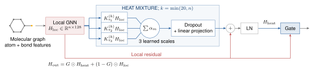

# HeatAdapter

用于分子性质预测的可学习多尺度热扩散适配器。代码将局部图神经网络与热扩散传播分支结合，并提供 MLP 容量对照和传播机制消融。

<p align="center">
  
</p>

*多尺度热扩散通过门控与局部分子消息传递融合。示意图保留论文中的原始谱截断标注；当前代码默认使用全谱。*

当前发布目录采用已修正的全谱实现。论文中的历史实验使用较早的截断实现，不能把历史精度当作本版代码的验证结果；本版完整对比训练尚待完成。随附示例仅验证程序运行。

## 安装

需要 Python 3.11 或更新版本。已在 Python 3.13、CPU 环境完成本地验证。

```bash
python -m venv .venv
source .venv/bin/activate
python -m pip install --upgrade pip
python -m pip install torch==2.10.0 --index-url https://download.pytorch.org/whl/cpu
python -m pip install -r requirements.txt
python -m pip install --no-deps -e .
```

Windows 使用 `.venv\Scripts\activate` 激活环境。GPU 环境请先安装匹配的 PyTorch CUDA 版本，再安装其余依赖。

## 立即运行

无需下载实验数据。仓库附带 55 个小分子的示例，目标值由 RDKit 计算分子量得到。

```bash
python -m unittest discover -s tests -v
python smoke_test.py

heatadapter-train \
  --csv examples/toy_molecules.csv \
  --backbones gcn --variants base,heat,mlp \
  --folds 0 --seeds 42 --learning-rates 0.001 \
  --epochs 2 --patience 2 --hidden 32 --depth 2 \
  --device cpu --output results/toy

heatadapter-predict \
  --checkpoint results/toy/custom/gcn_heat_fold0_seed42.pt \
  --csv examples/toy_molecules.csv \
  --output results/toy/predictions.csv
```

## 换成自己的数据

CSV 默认使用 `smiles` 和 `target` 两列，也可通过参数指定列名。输入应对应一个结构决定的回归任务；重复的标准化分子会合并并平均目标值。

```bash
heatadapter-train \
  --csv my_molecules.csv --smiles-column smiles --target-column target \
  --backbones gcn,gine --variants base,heat,mlp \
  --folds 0,1,2,3,4 --seeds 104729,130363,155921 \
  --device auto --output results/my_experiment
```

完整五折保证每个分子对每个模型和初始化恰好进入一次测试集；单独运行 `--folds 0` 只算局部诊断。模型选择仅使用验证集，标准化统计量仅从训练集计算。

原始五个研究数据集通过 `--datasets` 和 `--data-root` 读取，来源、文件名和字段见 [数据准备说明](datasets/README.md)。发布目录不包含论文稿件、实验权重、历史运行日志和原始研究数据。

同一命令可以继续尚未完成的实验。数据、代码或配置变化时，需使用新的输出目录。运行结果包含配置与输入哈希、数据清洗记录、划分记录、验证历史、选中模型、逐分子测试预测和误差指标。

更多模型、机制对照、历史分析工具和输出说明见 [英文 README](README.md) 与 [评估协议](docs/protocol.md)。代码采用 [MIT 许可证](LICENSE)。
